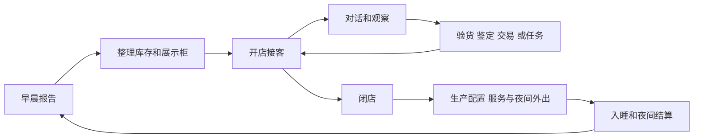

# Probably Automated MCP 设计草案

Probably Automated 按《深空当铺》的经营流程组织控制能力：在现金、空间、时间和风险约束下观察局面、判断货物、交易与加工，再处理夜间准备和长期经营。设计依据见 [132 个交互族及来源](game-interactions.md)。本文保留整体目标；0.2 已接入共用观察与执行层，实际接口、覆盖及尚未验收部分见 [实现说明](mcp-implementation.md)。

## 游戏循环与模块



这是一张经营流程图，实际游戏还允许在多个阶段整理和使用物品。模块共享同一套物品、时间和交互上下文；不能把每个玩法实现成彼此独立的世界模型。

| 模块 | 负责的问题 | 主要对象 |
| --- | --- | --- |
| 会话与界面 | 当前在哪、谁在说话、什么阻塞了操作 | Session、Context、Panel、Prompt、Dialogue |
| 店铺经营 | 开闭店、来客、展示与日结 | Shop、Visit、Display、DayReport |
| 库存与物品使用 | 物品在哪里、放得下吗、能对什么使用 | Item、Container、Slot、Tool |
| 柜台交易 | 买卖、批发、易物和议价 | Trade、Offer、Quote、Budget |
| 验货与鉴定 | 如何获得线索、提出判断和提交估价 | Inspection、Evidence、Estimate |
| 生产与机器 | 原料、电力、控制参数、进度和产物 | Machine、Control、Recipe、Power |
| 夜间活动 | 携带、出发、拾荒、采购与返回 | Location、Trip、Bag、Ground |
| 长期经营 | 人脉、服务、委托、许可、债务、治安与身体状态 | Contact、Upgrade、Request、Permit、Debt、Record |

这些模块是内部职责划分。最终 MCP 工具数量应根据常用流程和参数复杂度确定，不需要与模块数或按钮数相等。

## 观察与行动契约

保留当前 get_game_state、get_available_actions 的发现能力和 requestId 去重机制。动作由结构化参数表达，逐步替换 `dialogue_choice:<index>` 这类字符串拼接。以下名称只是接口草案。

| 能力 | 建议入口 | 返回或输入 |
| --- | --- | --- |
| 总体局面 | get_game_state | 当前上下文、关键经营指标、待处理提示、摘要与 snapshotId |
| 当前合法动作 | get_available_actions | actionId、kind、目标、参数范围、公开禁用原因与前置条件 |
| 库存详情 | get_inventory | 指定容器、分页与可访问嵌套内容，返回形状、位置、归属 |
| 当前对象 | get_entity | 当前可访问的顾客、交易、物品、机器或任务详情 |
| 实际视觉线索 | get_view | 当前场景或检查托盘图像，与 snapshotId 和目标关联 |
| 执行一次决定 | perform_action | actionId、结构化 arguments、expectedSnapshotId、requestId |
| 跟踪动作结果 | get_action_status | 按 requestId 取得结果、后续提示及完成依据 |

`get_entity` 不接受后台对象路径；只接受本会话已经暴露的实体引用。查询未打开容器或未检测物品时，应说明不可访问或尚未检测，不能借查询绕过开箱、验货和耗电。

对话、库存、交易等常用能力后续可以提供专用工具以改善参数提示，但都调用相同的内部处理器和校验。不要同时维护两套权限和执行语义。手册与已获得的经营知识可通过 MCP resources 提供，工具仍用于读取局面与行动。

## 局面需要同时表达多种状态

当前代码直接使用 PlayerStore.StoreState。完整枚举包含 `CLOSED`、`OPEN`、`MORNING`；它不能独自表示是否允许交易或外出。建议将上下文分开建模：

```json
{
  "sessionId": "session-reference",
  "snapshotId": "snapshot-reference",
  "context": {
    "shopState": "open",
    "location": "store",
    "transition": "none",
    "dialogueState": "waiting_for_choice",
    "activeVisitId": "visit-reference",
    "modalStack": ["dialogue-reference"],
    "inputLocks": ["trade"]
  }
}
```

示例只是协议形状，没有声称这些字段已在桥接中实现。机器运行与窗口打开、店门关闭与夜间出行应分别表示。角色名、地点 ID 和当前选项都从实际状态取得。

动作可用性按这一上下文计算：会话有效 → 当前场景可达 → 模态层级允许 → 当前流程允许 → 目标仍存在且可访问 → 游戏公开条件通过。执行前在主线程重新检查。

对于禁用原因，仅提供玩家能知道的原因。不能因为后台识别到某个隐藏身份，就提前出现一个暴露身份的动作或禁用说明。

## 物品与空间是共用基础

一件物品需要区分运行期引用、商品类型、玩家看到的名称、数量、归属、容器、形状与朝向。商品类型也可能透露伪装，应仅在玩家已知时公开；不能默认把后台 identifier 原样发送。相同显示名称不保证相同物品，相同商品也可能有不同品相和标签。

容器通过引用构成可访问的树或图：主库存、后仓、柜台、秤盘、展示柜、暗格、垃圾桶、背包、机器内部、夜间地面等。公开槽位的用途、可接受对象、空间和锁定条件。不要继续把主库存顶层列表当成全部资产。

移动首先校验归属、空间、形状和目标规则，再走原生移动流程及其回调。直接调用底层 Accept 或 Expel 是否足够，必须通过实机验证，不能因为方法公开就跳过柜台、展示柜和机器相关效果。物品嵌套查询需有深度、分页和循环保护，避免一次返回整局物品树。

通用物品操作拆成激活、切换、打开内容、工具用于目标、移动和数量操作。公开原生可用选项；工具专用参数交给对应适配器处理。

## 交易方向和报价

协议统一用店铺视角表示交易方向，0.2 沿用已有字段 `player_buys` 与 `player_sells`。顾客原始意图另存于 `customerIntent`，避免把顾客购买误当成店铺收购。[议价平板][bargaining] 与 [顾客需求面板][customer] 的表述视角不同。

每个当前交易应能读取摆货清单、需求限制、报价、剩余预算、拒收原因，以及是否已使用各方向议价机会。报价来自游戏正常可见流程，不由 MCP 按 Wiki 公式重新计算。

提交成交时绑定当前 visit、trade、物品、数量和报价上下文。复用原生确认与成交前再验货。超预算、特殊批发和易物可能需要额外确认或选择；返回下一步状态，由 AI 继续决定。[预算规则][customer]

委托原生自动选货时，要如实说明其选取行为。若游戏没有公开精确预览，就不能保证将交出某组指定物品；接口可返回可见的合格候选与无法保证选择顺序的说明。[委托交货][requests]

## 线索和答案的边界

| 信息类型 | 允许呈现的内容 | 获取方式 |
| --- | --- | --- |
| 商品宣称 | 显示名称、标签、卖家说法 | 正常提示或对白 |
| 外观证据 | 包装文字、印刷、颜色、印章、外形等可见细节 | 检查托盘图像或忠实的界面适配 |
| 检测结果 | 当前试纸、扫描仪或分析面板显示的数值与说明 | 正常使用工具并支付耗材或电力后 |
| 已获经营知识 | 已取得手册、新闻、文书和记录 | 玩家拥有或当前可读的资料 |
| 隐藏答案 | 未发现的真假、身份、鉴定正确价、未来掉落与剧情 | 不进入普通游戏控制接口 |

资料库、玩家当前已知信息和 AI 自己的推断应明确区分。曾经检测的液体在混合、过滤或换批后，旧结果应标记为历史结果，不能当成最新事实。扫描结果与本次顾客来访绑定。

视觉是必要能力：香烟图案、人物外貌等不能靠不完整文本替代。实现前可先用截图完成可见信息输入；随后再为明确的文字、数值和控件建立稳定的结构化适配。[验货流程][inspection]

## 机器共享控件并保留专用规则

官方机器窗口支持面板、物品栏、按钮、开关、滑条、范围滑条与标签页，可作为共用观察模型。先适配电源、模组、输入、输出、公开状态与进度，再为具体机器补充配方和专用操作。[官方机器窗口][modguide]

控件引用必须绑定当前机器、窗口和会话。滑条带范围、步长、单位和当前值；选项只接受当前列出的 ID。普通查询不触发扫描、加热、开箱或制造。

区分三种时间语义：点击后立即处理、现实时间中逐步处理、入睡结算时推进。MCP 不提供任意推进天数或直接完成生产；正常睡眠属于一次有成本的游戏行动。多机生产由 AI 规划，并通过通用物品转移连接流程。

## 动作执行与完成

继续复用当前主线程队列、会话隔离、过期快照检查和相同 UUID 重试规则。下面是对现有动作协议的扩展建议：

1. 动作只能选择本次局面可见的能力，参数在执行前重新验证。后台内部入口不得直接开放为反射调用。
2. `dispatched` 仍只表示处理函数已调用。另行区分 `in_progress`、`awaiting_input`、`completed`、`failed`、`partial` 与 `outcome_unknown`，并定义每种状态的完成依据。
3. 结果返回实际变化、相关事件、新提示和新的 snapshotId；失败时返回正常拒绝原因。调用函数后未抛异常不等于成交、到达或入睡完成。
4. 原生批量操作按其真实原子性处理。需要逐件执行时，保留逐件结果；不能虚构回滚已生效的成交或移动。
5. 会话切换使实体和动作引用失效。相同请求 ID 与不同参数冲突应拒绝；结果未知时不得用新 ID 自动重做。

snapshotId 应随影响决策的状态变化：当前选项、报价、归属、数量、模态、地点与锁定等。相机或无关动画帧不能无理由使每次动作过期。具体版本规则需要覆盖异步对话和多帧操作，不能把有效期完全交给轮询时刻。

## 实现顺序与验收

| 阶段 | 实现内容 | 可检查的完成标准 |
| --- | --- | --- |
| 1 | 上下文、对话推进、确认框、容器与柜台、基础买卖 | 从早晨报告到正常接客、成交、闭店、入睡，再读到次日结果；全过程不依赖手动补点击 |
| 2 | 议价、验货图像、检测结果与鉴定 | 根据可见线索完成一次对质和一次估价，保留错误判断的正常后果 |
| 3 | 人脉、服务、委托、背包和三处夜间地点 | 能解锁服务、交货、外出、装包返回并完成当晚结算 |
| 4 | 通用机器、供电、液体及基础生产 | 完成一条实际生产线的投料、加工、结算、检测和出售 |
| 5 | 专用机器、枪械、养殖、基因及长期剧情 | 按交互清单逐项验收当前可达变体，并保留明确的不支持项 |
| 6 | 开局矩阵与完整覆盖审计 | 每个可达原生交互均对应支持记录或明确缺口，有版本与场景证据 |

每阶段的验证覆盖成功与正常失败，特别是现金不足、空间不足、归属不符、交互锁、模态阻塞、目标失效和跨会话。既有假游戏测试继续验证协议；真实 UI 和原生副作用必须靠实机场景验证。

0.2 已实现结构化参数、动态原生控件、可见容器与工具操作、截图及请求结果查询。上表仍是实机场景验收顺序，不因共用入口可调用而自动标记通过；细分完成事件、专用机器状态和完整开局矩阵仍按实际场景补充。

[bargaining]: https://probablystolenguide.com/zh-hans/wiki/bargaining/
[customer]: https://probablystolenguide.com/zh-hans/guides/customer-requests/
[requests]: https://probablystolenguide.com/zh-hans/guides/marketplace-requests/
[inspection]: https://probablystolenguide.com/zh-hans/wiki/inspection-tools/
[modguide]: https://github.com/dragonpan2/probably-stolen-modding/blob/2bce9d264ab2386fed0adc49ef8ae3ce189601ef/ModdingGuide.zh-CN.md
